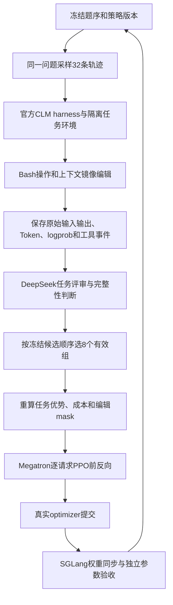

# 框架与实际接线

## 通俗理解

模型一边完成研究任务，一边通过 Bash 编辑自己的上下文镜像文件。每次调用真正送入模型的内容单独保存。评审器在轨迹结束后判断答案，训练器用完整轨迹的成绩和成功条件下的计算成本，更新 Qwen 的语言参数。

一次逻辑任务可以产生许多模型调用。每次调用都是一个训练片段，但一次正式更新要求8个问题各32条完整轨迹。任务数、轨迹数、模型调用数、训练片段数和 optimizer 更新数分别计数。



## 组件

| 组件 | 实际作用 | 对应代码 |
|---|---|---|
| 数据适配 | 官方OpenResearcher题目、训练/验证选择与固定题序 | `framework/management/prepare_data.py`及`framework/data/MANIFEST.json` |
| 执行器 | 官方CLM harness，Bash及上下文镜像读写 | `framework/agent-bundle-v1/clm_replication/agent_runner.py`及官方harness |
| Polar协调器与网关 | 管理独立任务、容器、会话、请求路由和策略版本 | `framework/source-revisions/training-v10/clm_replication/gateway.py`、`polar_agent.py`与固定ProRL |
| 检索 | Web search/fetch及任务所需资料，保留工具输入输出 | `web.py`及仓库`implementation/retrieval/` |
| 评审 | 独立DeepSeek API，二值结果、格式/终态与usage留档 | `judge.py`、`evaluator.py`、`judge_rubric.txt` |
| 轨迹转换 | 按每次真实调用生成Sample，保留原输入和生成概率 | `bridge.py`及`framework/src/ProRL/src/slime_bridge/adapter.py` |
| 奖励与优势 | 同题任务优势及成功门控效率优势 | `rewards.py`、`advantages.py`及`dual_channel_advantage.py` |
| 训练 | Slime/Megatron、TP4、BF16、全语言参数、CPU optimizer offload | `framework/management/train-v14.sh`与`framework/src/slime/` |
| 留存与独验 | 原始请求/工具/事件、账本、逐Token数据、实际参数变化 | `accounting.py`、`weight_provenance.py`及仓库`implementation/management/` |

## 模型和资源

起点是官方 `Qwen/Qwen3.5-9B`。本轮主模型的执行与上下文编辑使用同一策略，权重通过 RL 更新。评审模型按用户要求使用 `deepseek-v4-1-flash-261017` API。

后续授权将物理GPU4/5扩展为4/5/6/7。实际布局是四卡TP4、DP1、PP1、CP1，训练和推理分时复用设备。语言参数BF16，逻辑batch256，microbatch1。实际训练采用FA2、logprob chunk512及trainer侧TileLang。严格前缀合并和重计算层数扩大候选在真实梯度检查中未获采纳。

原论文采用更多H200资源。本环境的吞吐和耗时只代表本次四卡布局。judge替换、数据筛选、预算解释和工程适配在原计划中逐项记录。

## 时间关系

```text
固定策略v
→ 完整采样及题末独立评审
→ 完整性与组方差筛选
→ 当前v的8×32轨迹入训练
→ 一次参数更新
→ 同步v+1
→ 下一批采样
```

同一批保持单一策略版本。每次模型调用保存当时的真实输入，后续上下文编辑不会回写早先调用的训练输入。公开准备模块的CPU检查与正式模型更新分开验收。

## 奖励

记任务成功为 `y`，缺工具和格式失败分别为 `no_tool`、`format_failure`。

```text
r = y - (1-y) × (0.3 × no_tool + 0.2 × format_failure)
A_out = (r - 同题32轨迹均值) / (同题样本标准差 + 1e-6)

S = 成功且clean_finish的同题轨迹
若S少于2条，a_eff = 0
否则成功轨迹a_eff = clip((S的平均FLOPs - 自身FLOPs) / 平均FLOPs, -1, 1)
失败轨迹a_eff = 0

A_token = A_out + 0.25 × a_eff × role_mask
```

FLOPs由每次调用的输入、生成长度和相对前一次输入的精确Token前缀重算。`loss_mask`只覆盖实际生成Token。额外效率信用只施加到符合官方操作判据的纯编辑回合。

纯编辑的实际标签要求镜像变化、命令退出0且输出为空。该操作判据仍不能证明任意Bash命令完全没有其他静默副作用。缺Token、缺logprob、缺SSE尾部或评审不明确均保留invalid/null。

逐请求构造导致长历史在训练中多次出现，输入Token出现次数会高于唯一文本长度。总Token账本记录实际生成/API调用，PPO重复前反向的计算另行观察。
